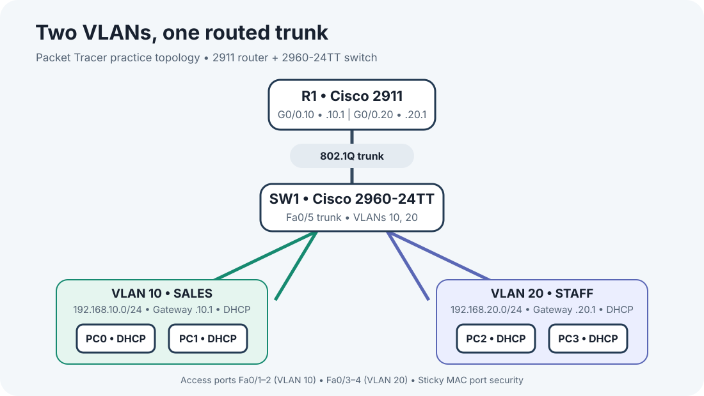

# Introductory Two-VLAN Packet Tracer Lab

This is a small personal practice lab built in Cisco Packet Tracer 9.0.1 while learning networking fundamentals. It covers basic VLAN setup, DHCP, router-on-a-stick routing, and switch port security. It is a simulated learning exercise, not a production network.

## Topology

- Cisco 2911 router (Packet Tracer label: Router0) connects from G0/0 to Switch0 Fa0/5 as an 802.1Q trunk. The configured switch hostname is SW1.
- Cisco 2960-24TT switch with four PC access ports.
- VLAN 10 (SALES): Fa0/1–Fa0/2, network 192.168.10.0/24, gateway 192.168.10.1.
- VLAN 20 (STAFF): Fa0/3–Fa0/4, network 192.168.20.0/24, gateway 192.168.20.1.
- Router subinterfaces G0/0.10 and G0/0.20 provide the VLAN gateways and routing between the VLANs.

## What I configured

- Two VLANs and access-port assignments on the switch.
- An 802.1Q trunk between the switch and router.
- Router subinterfaces and DHCP pools for both VLANs.
- Sticky MAC learning, a one-MAC limit, and restrict violation mode on the four PC-facing ports. PortFast is enabled on those ports.

The example configuration files omit enable-password commands. Port security is configured, but I have not recorded a test that triggers a security violation.

## What I verified

In the saved simulation, PC0 and PC2 are set to DHCP. PC0 received 192.168.10.21/24 with gateway 192.168.10.1; PC2 received 192.168.20.21/24 with gateway 192.168.20.1. The router listed PC2's DHCP lease as automatic.

PC0 successfully pinged its gateway and PC2 across VLANs (4/4 replies for each). Router subinterfaces were up/up, and spanning tree showed the uplink forwarding in both VLANs. PC1 and PC3 were not included in the client tests.

See [verification-results.md](verification-results.md) for the commands and results.

## Files

- `Packet Tracer VLAN Lab.pkt` — editable simulation.
- `topology.svg` — topology diagram.
- `router-config.txt` and `switch-config.txt` — example configuration commands.
- `verification-results.md` — recorded DHCP and connectivity checks.

## Repeat the checks

Open the .pkt file in Packet Tracer. On the router, run `show ip interface brief`, `show ip dhcp pool`, and `show ip dhcp binding`. On the switch, run `show vlan brief`, `show interfaces trunk`, and `show port-security interface fa0/1` (repeat for Fa0/2–Fa0/4). On PC0 and PC2, choose Desktop → IP Configuration → DHCP, then ping the gateway and a client in the other VLAN.
